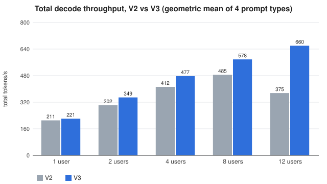
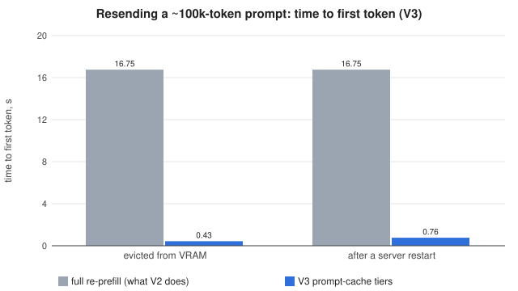

# Qwen3.8-Flash-Next on one RTX PRO 6000 — V3

Serving recipe for `Qwen/Qwen3.8-Flash-Next` in EXL3 `3.18bpw_h6_ng8`
([turboderp/Qwen3.8-Flash-Next-exl3, branch 3.18bpw_h6_ng8](https://huggingface.co/turboderp/Qwen3.8-Flash-Next-exl3/tree/3.18bpw_h6_ng8))
on a single 96 GiB RTX PRO 6000 Blackwell (SM120), with TabbyAPI, a 21-patch exllamav3, the DFlash2 drafter, a
3M-token shared KV pool, up to 512k tokens per request and 12 concurrent requests.

## V3 at a glance

|What|V2|V3|Change|
|---|---|---|---|
|Resend a 100k-token prompt after it was evicted from VRAM|16.75 s (prefilled again)¹|**0.43 s**|**39× faster**|
|Resend it after a server restart|16.75 s (prefilled again)¹|**0.76 s**|**22× faster**|
|12 users, code (`matrix.py`)|573.1 t/s²|**901.3 t/s**|**1.57×**|
|8 users, code (`matrix.py`)|708.4 t/s|**881.5 t/s**|1.24×|
|Requests served at once|9|**12**|+3|
|1 user rewriting a ~1.5k-token file with one change|337.2 t/s³|**463.3 t/s**|**+37 %**|
|VRAM after load|91.8 GiB (pool allocated)|**59.2 GiB** (pool mapped as it fills)|−32.6 GiB|
|VRAM free at the run's peak|2.6 GiB|**6.9 GiB**|+4.3 GiB|
|Cold 520k-token prompt to first token|96.6 s|**87.9 s**|1.10×|
|Exact-answer probe (50 questions)|50/50|**50/50**|unchanged|

¹ V2 has no RAM or disk prompt-cache tier; the V2 column is the same prompt sent cold (measured on V3, same prefill path).
² V2 serves at most 9 requests at once; at 12 users, 3 wait in its queue (as measured).
³ Same prompt, identical output text, host load ~11 on both; V3 median of 3 (405-464 t/s), V2 one run.

**Since v1** (the original recipe: stock exllamav3, 8-bit KV): 8 users, code 453.7 → 881.5 t/s (1.94×); 1 user,
code 231.1 → 313.5 t/s (1.36×).⁴

⁴ `bench/matrix.py`, same card, harness and prompt; v1 and V3 measured in separate sessions.





Every number above and below is from `docs/measurements.md` (section "README run" unless noted); V3 is as shipped,
YaRN factor 2.

## Measured, V2 against V3

**Same harness as the V2 release** (`bench/matrix.py`: 512-token greedy replies, send to last token, total t/s,
median of 3; one boot per release):

|`matrix.py`|1 user|8 users|12 users|
|---|---|---|---|
|V2, code|313.0 t/s|708.4|573.1²|
|V3, code|313.5|**881.5**|**901.3**|
|change|+0.2 %|+24.4 %|**+57.3 %**|
|V2, math|297.6|684.7|559.8²|
|V3, math|297.5|**805.2**|**844.5**|
|change|−0.0 %|+17.6 %|**+50.9 %**|

**Per prompt type, 1-12 users** (`bench/final.py`: 512 forced tokens per request, greedy, t/s from each stream's
first token, median of 3, one boot per release):

|Users|Prompt|V2 total|V3 total|Change|V2 per user|V3 per user|
|---|---|---|---|---|---|---|
|1|prose|144.6|**149.2**|+3.2 %|144.6|149.2|
|1|chat|175.0|**189.4**|+8.2 %|175.0|189.4|
|1|code|241.3|**256.9**|+6.5 %|241.3|256.9|
|1|math|323.0|**328.4**|+1.7 %|323.0|328.4|
|2|prose|211.8|**237.6**|+12.2 %|106.8|120.6|
|2|chat|256.5|**289.8**|+13.0 %|129.6|147.5|
|2|code|331.4|**393.3**|+18.7 %|170.4|206.4|
|2|math|461.7|**546.5**|+18.4 %|235.1|273.4|
|4|prose|289.4|**341.1**|+17.9 %|72.8|89.7|
|4|chat|365.5|**391.9**|+7.2 %|92.4|105.4|
|4|code|455.0|**575.1**|+26.4 %|118.3|154.6|
|4|math|601.1|**674.2**|+12.2 %|157.7|190.5|
|8|prose|339.3|**419.4**|+23.6 %|46.9|58.2|
|8|chat|402.1|**487.5**|+21.2 %|55.5|69.1|
|8|code|544.7|**664.6**|+22.0 %|78.5|103.8|
|8|math|743.0|**819.5**|+10.3 %|105.5|133.2|
|12|prose|273.4|**510.5**|+86.7 %|33.7|50.7|
|12|chat|324.2|**587.2**|+81.1 %|39.8|58.9|
|12|code|425.5|**768.0**|+80.5 %|52.6|80.9|
|12|math|525.6|**823.5**|+56.7 %|71.9|95.0|

Geometric mean over the four prompts, total t/s: 1 user 210.7 → 221.0 (+4.9 %), 2 users 302.0 → 348.8 (+15.5 %),
4 users 412.4 → 477.2 (+15.7 %), 8 users 484.8 → 577.7 (+19.2 %), 12 users 375.2 → 659.9 (**+75.9 %**).⁵

⁵ One boot per release; single cells vary up to ±15 % between runs at 4-8 users (run ranges in `docs/measurements.md`).

**Prefill, cold prompt → first token** (fresh nonce each time):

|Prompt|V2|V3|Change|
|---|---|---|---|
|~2k tokens|0.57 s (3,541 t/s)⁶|0.59 s (3,438 t/s)|−3 %|
|32k|5.53 s (5,695 t/s)|**5.31 s (5,933 t/s)**|+4.2 %|
|128k|23.1 s (5,683 t/s)⁶|**21.7 s (6,038 t/s)**|+6.2 %|
|520k|96.6 s (5,385 t/s)|**87.9 s (5,915 t/s)**|+9.8 %|
|worst of 5 cold 32k requests|—|5.61 s (median 5.19 s)| |

⁶ V2's 2k and 128k from the release run's A, A, B, B (same harness); V3 from this README run.

**Prompt cache, ~100k-token prompt** (V3; `bench/prompt_cache.py`):

|Case|V3 time to first token|Tokens served from cache|
|---|---|---|
|sent cold|16.75 s|0|
|resent at once (pages in VRAM)|0.18 s|99,840 of 99,997|
|resent after 3.1M tokens of other prompts evicted it from VRAM (RAM tier)|**0.43 s**|99,840|
|resent after a server restart (disk tier)|**0.76 s**|99,840|

**One request at a time, 2048 forced tokens** (`bench/decode_natural.py`, median of 3, one boot per release):

|Prompt|V2, greedy|V3, greedy|Change|V3, `qwen38_thinking` preset⁷|
|---|---|---|---|---|
|prose|127.3 t/s|127.4 t/s|+0.1 %|123.4 t/s|
|code|289.1|**306.8**|+6.1 %|276.4|
|chat|155.8|152.1|−2.4 %|152.3|
|math|319.8|**329.3**|+3.0 %|321.2|

⁷ Temperature 0.6, top-k 20, top-p 0.95: this repo's choice (Qwen recommends temperature 1.0 for thinking mode);
clients that send their own sampling settings keep them.

**Quality:** 50/50 on the exact-answer probe for both releases (`bench/accuracy.py`); a passphrase planted halfway
into a 520k-token prompt is retrieved; next-token top-1 agreement with V2 25/25 (16 short, 9 long prompts up to 157k)
with KL 0.0010-0.0014 short and 0.0018 long against a V2-vs-V2 floor of 0.0004 / 0.0000 (YaRN factor 4);⁸ YaRN
factor 2 against factor 4: top-1 16/16, KL 0.015 (the position encoding itself changes).

⁸ Rounding-level drift from patch 0017 and the adaptive prefill chunks; details under "Trade-offs".

## What it takes

- One RTX PRO 6000 Blackwell (96 GiB). Measured on the Max-Q (300 W) edition; every run here sat at the power cap
  ("SW Power Cap" throttle) during decode and prefill.
- Host RAM: **plan for 320 GB or more.** The server holds ~250 GiB: the 192 GiB pinned RAM tier of the prompt cache
  (`memory.sysmem_kv_cache`, committed at start), the 48.3 GiB engram table locked in RAM (memlock ≥ 50 GiB;
  `launch.sh` checks it), and up to 64 GiB of recurrent-state checkpoints (`memory.sysmem_recurrent_cache`). Without
  the RAM tier (`sysmem_kv_cache: 0`, and no disk tier, which needs it) the server needs ~60-120 GiB as in V2.
- Disk: ~100 GiB for the model, plus up to 200 GB for the disk tier of the prompt cache (`memory.disk_cache_dir`,
  `disk_cache_size`) on a fast NVMe.
- The model: [`turboderp/Qwen3.8-Flash-Next-exl3`](https://huggingface.co/turboderp/Qwen3.8-Flash-Next-exl3/tree/3.18bpw_h6_ng8),
  branch `3.18bpw_h6_ng8` (measured at revision `2bfc9dade6be0b5b42e2b381d7a6cc160c1d409c`). About 100 GiB on disk,
  half of it the engram (n-gram embedding) table.
- Python 3.12, PyTorch 2.11 with CUDA 13 (`cu130` wheels), flash-linear-attention 0.6.0, the CUDA toolkit
  (`nvcc`, for the extension's JIT build) and `ninja`. Use an environment without a pip-installed exllamav3: its
  prebuilt extension would shadow the patched build (`launch.sh` refuses to start in that case).
- [exllamav3](https://github.com/turboderp-org/exllamav3) `v1.6.4` + `engine/patches` (21 patches).
- [TabbyAPI](https://github.com/theroyallab/tabbyAPI) `564f8fb` + `deploy/tabbyapi-v3.patch`.
- Drafter: [`incoai/Qwen3.8-Flash-Next-DFlash2`](https://huggingface.co/incoai/Qwen3.8-Flash-Next-DFlash2)
  (measured at revision `a22a1744e85c17364dcc54a6a420af7135d4c7f6`).

## Setup

```bash
# environment
python3.12 -m venv venv && . venv/bin/activate
pip install torch==2.11.0 --index-url https://download.pytorch.org/whl/cu130

# engine
git clone https://github.com/turboderp-org/exllamav3 && cd exllamav3
git checkout v1.6.4 && git am /path/to/repo/engine/patches/*.patch
pip install -r requirements.txt flash-linear-attention==0.6.0 && cd ..

# server
git clone https://github.com/theroyallab/tabbyAPI && cd tabbyAPI
git checkout 564f8fb && git apply /path/to/repo/deploy/tabbyapi-v3.patch
pip install .
cp /path/to/repo/deploy/sampler_overrides/qwen38_thinking.yml sampler_overrides/ && cd ..

# model and drafter
# (the revisions every number here was measured on; the model's branch is 3.18bpw_h6_ng8)
hf download turboderp/Qwen3.8-Flash-Next-exl3 --revision 2bfc9dade6be0b5b42e2b381d7a6cc160c1d409c \
  --local-dir /path/to/models/Qwen3.8-Flash-Next-exl3-3.18bpw_h6_ng8
hf download incoai/Qwen3.8-Flash-Next-DFlash2 --revision a22a1744e85c17364dcc54a6a420af7135d4c7f6 \
  --local-dir /path/to/drafts/Qwen3.8-Flash-Next-DFlash2

# long context (needed for the 512k limit): apply the YaRN factor-2 change to the model's config.json
(cd /path/to/models/Qwen3.8-Flash-Next-exl3-3.18bpw_h6_ng8 && patch -p1 < /path/to/repo/deploy/model-config-yarn2.patch)

# edit deploy/config.yml: model_dir, draft_model_dir, memory.disk_cache_dir, network.port, auth; then
ulimit -l 52428800      # memlock for the engram lock (or LimitMEMLOCK=52428800K in a systemd unit)
TABBY=$PWD/tabbyAPI ENGINE=$PWD/exllamav3 GPU=0 ./deploy/launch.sh
```

`launch.sh` sets the engine switches, waits for the model and sends one 128-token warm-up request before serving
(see "Server history"). Startup takes ~80-90 s: the 192 GiB RAM tier is committed and page-locked at load.

## Upgrading from V2

- **Model config:** restore the model's original `config.json` (or reverse V2's patch:
  `patch -R -p1 < model-config-yarn4.patch` from V2's `deploy/`), then apply `deploy/model-config-yarn2.patch`. The two
  patches change the same lines, so the factor-2 patch does not apply on top of factor 4.
- **Engine and server:** check out exllamav3 `v1.6.4` again and apply this release's `engine/patches` (21 patches; they
  replace V2's 0001-0007, not add to them). For TabbyAPI, start again from `564f8fb` and apply `deploy/tabbyapi-v3.patch`
  in place of V2's `tabbyapi-prefill-chunk-size.patch` (V2 already offered the v3 patch as an option; if you used it,
  keep it). Use this release's `deploy/launch.sh`: it sets the new engine
  switches.
- **`config.yml` keys that changed:** `max_seq_len` 655360 → 524032, `max_batch_size` 9 → 12; new: `prefill_chunk_size:
  16384`, `shared_chunk_size: 4096`, `hybrid_draft_tokens: 16`, `sysmem_kv_cache: 196608`, `disk_cache_dir`,
  `disk_cache_size: 204800`. `cache_size`, `chunk_size`, the drafter settings and `sysmem_recurrent_cache` are unchanged.
- **Host:** plan for 320 GB of host RAM or more (the server holds ~250 GiB with the RAM tier; V2 ~60-120 GiB), and for a
  start of ~80-90 s instead of ~45 s, so raise any health-check or restart timeouts.
- **Disk tier:** create the directory before the first start, on a fast NVMe with 200 GB free, e.g.
  `mkdir -p /path/to/kv-cache && chmod 700 /path/to/kv-cache`, and set `memory.disk_cache_dir` to it (see "Prompt
  cache" under Details for what it stores).

## What's new in V3

|Change|Ships in|Measured effect (that change alone)|
|---|---|---|
|12 concurrent requests: decode graphs for 12 jobs, a 64-row cap on verify rows per round|0019, 0021, `max_batch_size: 12`|12 users 1.57× V2 (`matrix.py`, code)|
|Prompt-cache RAM (192 GiB) and NVMe tiers|`memory.sysmem_kv_cache`, `disk_cache_dir`|evicted 100k prompt 16.75 → 0.43 s; after a restart 0.76 s|
|Growable KV pool|0010-0015|VRAM after load 91.8 → 59.2 GiB|
|Adaptive prefill chunks up to 16k + TabbyAPI patch v3|0006, 0013, 0014, `prefill_chunk_size: 16384`|cold 128k +5-9 %, 2k −3..−7 %|
|Hyper-connection int8 tables built once|0016|8 users +9-10 %|
|Shared expert of a wide verify window as one launch|0017|8 users +6-15 %|
|Batched speculative accept (+ the no-op sampler flag fix)|0018|8 users +4-7 %|
|Drafter's next block under the host accept loop|0021, `EXL3_SD_DRAFT_OVERLAP=1`|8 users within noise (prose +2.2 %, code −0.6 %)|
|Hybrid (suffix-match) drafting while one request is active|0021, `hybrid_draft_tokens: 16`|1 user file rewrite +20 % against V3 with it off|
|Counting-sort run table for wide verify windows|0020|rotation launch 50-60 → 8-9 µs|
|YaRN factor 4 → 2, 512k per request|`deploy/model-config-yarn2.patch`|1 / 2 / 8 users +0.6 / +3.6 / +4.2 %|
|Bench: first-token timing, release benchmark, needle, prompt-cache and chat exact-answer probes; gate policy|`bench/`|—|

Numerics, switches and the measurements behind each row: `engine/README.md` and `docs/measurements.md`
("What's new in V3, per item").

## Trade-offs

- **Host RAM ~250 GiB** for the 192 GiB prompt-cache RAM tier; lower or zero `sysmem_kv_cache` on a smaller host.
- **Rounding-level drift**: greedy text differs from V2 at near-tie tokens; next-token top-1 25/25, KL 0.001-0.002.
- **512k per request** instead of 640k (YaRN factor 2); factor 4 restores 640k+ at ~4 % lower throughput at 2-8 users
  (no measurable difference at 1 user).
- **Cold 2k prefill 3-7 % slower** (0.57 → 0.59-0.62 s); long prompts gain.
- **Per-user speed at 12 users** is 69 t/s (V2: 47); it is lower than at 8 users, as on any server.
- **Slower start**: ~80-90 s to ready (V2 ~45 s), the RAM tier is page-locked at load.

Details for each: `docs/measurements.md`.

## Details

**Model.** Hidden 2560, 48 layers (12 sparse full-attention + 36 Gated DeltaNet linear-attention), 512 experts
with 10 routed + 1 shared active per token, hyper-connections, vocab 248,320. The checkpoint is trained at 262,144
positions.

**Context length.** `deploy/model-config-yarn2.patch` applies static YaRN factor 2 (524,288 positions);
`max_seq_len: 524032` leaves one 256-token page for the draft and verify positions of a request at the limit
(drafts are up to 16 tokens with hybrid drafting). V2 used factor 4 (1,048,576 positions, 640k per request); the
smaller factor drafts slightly better, likely because the drafter was trained without YaRN (`docs/measurements.md`,
"YaRN factor 4 → 2").

**KV capacity.** 6-bit K/V costs 13.5 KiB per token; 3.75 KiB of that is fixed fp16 planes for the sparse-attention
indexer. The 3M-token pool (2,999,808, a multiple of 256) is reserved as virtual memory at load and mapped in
256-page steps as requests use it; when the queue drains, mapped pages are released from the top until 10 GiB are
free, so prefill gets the room for 16k-token chunks back. Each request can use up to 524,032 tokens. Twelve
full-length requests would need 6.3M tokens, more than the pool: the generator reserves pages for a request's prompt
plus its next output chunk, so when the pool runs short a new or continuing request waits for pages rather than
failing.

**Prompt cache.** Three tiers: the GPU pool, a 192 GiB pinned-RAM tier and a 200 GB disk tier. A prompt page evicted
from the GPU pool moves to RAM; pages entering RAM, and the recurrent checkpoints, are written through to disk
(`disk_cache_dir`), where a later server process finds them. The disk tier is keyed by the model's config and
weights, so a config change (such as the YaRN factor) starts a fresh subdirectory. 197 checkpoints were held after a
3.1M-token fill test, well inside the 64 GiB budget.

Privacy: the RAM and disk tiers hold the KV of users' prompts, and the disk tier keeps it across restarts. Put
`disk_cache_dir` on storage only the server's account can read, and clear it (stop the server, delete the directory's
contents) when prompts must not persist, for example after a tenant leaves a multi-tenant setup. `sysmem_kv_cache: 0`
and no `disk_cache_dir` turn both tiers off.

**Drafting.** DFlash2 drafts 8-token blocks: the first position of a block is the anchor (the last accepted token),
so a block carries 7 drafts, and `draft_num_tokens: 7` uses all of them. Draft acceptance drives single-stream
speed: about 4-5 accepted drafts per round on code and math sent as plain prompts, 1-2 on prose and chat. Sent as
chat messages with thinking on, the same code prompt drops to ~1.6-1.9 (the reply opens with free-form reasoning),
while math stays at ~4.5-4.8. With one active request, a
16-token suffix match against the request's own context (hybrid drafting) replaces the DFlash2 block when the match
is long and agrees with it: rewriting a file with one small change accepts 991 of 1,068 tokens (929 without it).

**Engram table.** 48.3 GiB of n-gram embeddings read per token. Locked in RAM it costs 48.3 GiB of host memory
and removes disk reads from the critical path. Streamed from disk (`EXL3_NGRAM_LOCK=0`) it uses ~4 GiB RSS, but a
cold request can stall when the page cache is under pressure.

**Prefix cache under load.** Reusing a cached prompt prefix on this model needs two things: the prefix's KV pages
still in the GPU pool, and a saved state for the 36 linear-attention layers at that point (a "recurrent checkpoint",
~104 MiB each, kept in system RAM). TabbyAPI's default checkpoint budget (`memory.sysmem_recurrent_cache: 4096` MB)
holds only ~39. Under a coding-agent workload (15-22 concurrent conversations of 50-500k tokens) that budget ran out:
checkpoints of conversations waiting for their next turn were evicted, every turn re-prefilled from scratch, queues
passed client timeouts, and timed-out clients resent the same long prompts. Measured on the live server: 93-99 % of
prompt tokens served from cache with ≤12 conversations in flight, 2-10 % once that pattern set in. `deploy/config.yml`
therefore sets 65536 MB (~640 checkpoints); right after the change, 77 % of prompt tokens came from cache with a cold
cache, median queue 2 s and no timeouts.

If you front the server with a router or gateway:
- keep requests in flight at or below `max_batch_size` (12) and their combined prompts well below the KV pool (we use
  ~80 %, 2.4M tokens); send the overflow to another backend instead of letting it queue in this server, where every
  queued long prompt evicts other conversations' cached prefixes;
- time out on lack of progress (no streamed chunk for N minutes) rather than a fixed total, so long answers are not
  cut off and then resent in full.

**Admission.** `max_batch_size` is 12. The batched-cache decode graphs cover up to 12 jobs (patch 0019) and the
verify-row cap (`EXL3_DRAFT_MAX_ROWS=64`) trims each round's draft width so 9-12 jobs stay inside the 64-row
captured paths: 8 jobs keep the full 7 drafts, 9-12 jobs get 6-4. With 12 users V3 serves 1.57× V2's total on
`matrix.py` code (+75.9 % on the four-prompt mean) and each user still gets ~69 t/s. VRAM after load is 59.2 GiB
with the growable KV pool.

**Server history.** With the drafter attached, a freshly started server's first ~74 decoded tokens can differ
slightly from later requests; for example a raw `2+2=` as the very first request can complete with 5 instead of 4.
The launcher's 128-token warm-up absorbs this. More generally, greedy text on this stack can depend slightly on
what the server has decoded since start (near-tie tokens; batched KL 0.0015). V2 behaves the same way.

**Prefill while others decode.** A new prompt shares the GPU with running decodes: by default it takes one
4096-token chunk every fifth generator step. With four users decoding, a cold 131k prompt reaches its first token
in 35 s and the decoders run at about a fifth of their speed meanwhile. TabbyAPI patch v3
(`deploy/tabbyapi-v3.patch`) exposes the two knobs: `prefill_cooldown` (steps between chunks)
and `shared_chunk_size`. Measured on the V2-era build (2026-11-15, before V3's decode changes), 4 decoders + one
cold 131k prompt:

|`prefill_cooldown` / `shared_chunk_size`|time to first token|decoders during the prefill|
|---|---|---|
|16 / 2048|86 s|−30 %|
|8 / 4096|41 s|−71 %|
|4 / 4096 (default)|35 s|−80 %|
|0 / 8192|25 s|−96 %|

No setting keeps the decoders within 15 %: every chunk stalls all decoders for its whole duration, so faster
first tokens cost decode speed linearly. Lower the cooldown for agent traffic where the new prompt's user is
waiting; raise it where streaming users must stay smooth.

## Repository

```
deploy/   launch.sh, config.yml, YaRN config patch, TabbyAPI patch v3
engine/   exllamav3 patch series (21 patches) and its README
bench/    the harnesses behind the tables: matrix.py (V2's headline method), final.py (decode / prefill with
          first-token timing), decode_natural.py (2048-token single requests), prompt_cache.py, needle.py,
          coldttft.py, accuracy.py (chat, exact answer), accuracy_raw.py (V2's probe), identity_kl.py, prefill under
          load, the fill/drain soak, the nsys prefill profiler
docs/     measurements.md: every number in this README and how it was measured, per-change A/B results;
          provenance.md: where each V3 item comes from; img/: the two charts and the script that draws them
```

Run the benchmarks against a running server, e.g.
`BASE_URL=http://127.0.0.1:5000 API_KEY=<api_key from tabbyAPI/api_tokens.yml> python bench/final.py --label run1 --out run1.jsonl`.
See `bench/README.md` for each script, the timing definitions and the gate policy for changes.

## Credits

Models and code this recipe runs on, v1 to V3:

- **Qwen3.8-Flash-Next** ([model](https://huggingface.co/Qwen/Qwen3.8-Flash-Next)): Qwen team, Alibaba. Qwen
  Community License 1.0; weights are not redistributed here.
- **The EXL3 quant**, [`turboderp/Qwen3.8-Flash-Next-exl3`, branch `3.18bpw_h6_ng8`](https://huggingface.co/turboderp/Qwen3.8-Flash-Next-exl3/tree/3.18bpw_h6_ng8):
  turboderp ([@turboderp_](https://x.com/turboderp_)). Every number in this repository, v1 included, was measured on
  it. It is one of the model card's self-calibrated quants, made with exllamav3's
  [self-calibration pipeline](https://github.com/turboderp-org/exllamav3/blob/master/doc/optimize.md) (per-tensor
  bitrates solved from measured sensitivities), not a standard `convert.py --bits` conversion.
- **exllamav3** ([GitHub](https://github.com/turboderp-org/exllamav3)): turboderp and contributors, MIT. EXL3 format,
  kernels, DFlash2 support and the self-calibration pipeline; V2's patches 0004, 0005 and 0007 extend its coop MoE
  kernels, CUDA-graph machinery and DFlash2 generator.
- **TabbyAPI** ([GitHub](https://github.com/theroyallab/tabbyAPI)): kingbri ([@kingbri1st](https://x.com/kingbri1st))
  and contributors, theroyallab, AGPL-3.0.
- **DFlash2 drafter** ([`incoai/Qwen3.8-Flash-Next-DFlash2`](https://huggingface.co/incoai/Qwen3.8-Flash-Next-DFlash2)):
  Inco AI ([@inco_ai](https://x.com/inco_ai)), Apache-2.0, building on [DFlash](https://github.com/z-lab/dflash)
  (z-lab) by Jian Chen ([@jianchen1799](https://x.com/jianchen1799)), Yesheng Liang and Zhijian Liu
  ([@zhijianliu](https://x.com/zhijianliu)).
- **flash-linear-attention** ([GitHub](https://github.com/fla-org/flash-linear-attention)): Songlin Yang
  ([@SonglinYang4](https://x.com/SonglinYang4)), Yu Zhang ([@yzhang_cs](https://x.com/yzhang_cs)) et al., MIT.
- **YaRN** ([paper](https://arxiv.org/abs/2309.00071)): Bowen Peng, Jeffrey Quesnelle
  ([@theemozilla](https://x.com/theemozilla)) et al. The context-extension method behind the model-config patch: v1
  and V2 run factor 4, V3 factor 2.
- **QMesh R5** exllamav3 fork ([GitHub](https://github.com/GPTwareAiTeam/QMesh-1xRTXPro6000-1xGB10), GPTwareAiTeam,
  MIT), on which V2 builds: the cooperative MoE k-loop (0001), the dense decode GEMV (0002), the readback-free fused
  MoE dispatch (0003) and the adaptive prefill limiter (0006) are ported from it, as is the A, A, B, B /
  next-token-KL measurement method used for every number here. The growable KV pool (patches 0010-0015) ports its
  growable cache: `cache/native/vmm_pool.cpp` and the `VmmRange` wrapper on CUDA virtual memory management. What
  each V3 item owes to it (0008, 0009, 0010-0015, 0020, and 0004/0005, which V2's credits did not name):
  `docs/provenance.md`.

Hybrid drafting and the DFlash2 drafter code are upstream exllamav3; `deploy/tabbyapi-v3.patch` and the bench
scripts are this repository's own work.

**Reference points** (not code credits: none of their code is in this repository). Public recipes and benchmarks
we compared against, or that shaped what we tested:
- [Mia's AI Lab](https://x.com/MiaAI_lab): the Flash-Next recipes on TensorFold, e.g.
  [Qwen3.8 Flash Next on one RTX PRO 6000](https://github.com/MiaAI-Lab/Qwen3.8-Flash-Next-RTX-PRO-6000-TernsorFold)
  and the [TensorFold Flash-Next recipe](https://github.com/MiaAI-Lab/TensorFold/blob/main/docs/recipes/qwen3.8-flash-next.md);
  [TensorFold](https://github.com/ashhart/TensorFold) itself is by Ash Hart ([@ashxhart](https://x.com/ashxhart)).
- bertholomus ([@bertholomusai](https://x.com/bertholomusai)):
  [Qwen3.8-Flash-Next-NVFP4-GPTQ](https://huggingface.co/bertholomus/Qwen3.8-Flash-Next-NVFP4-GPTQ).
- turboderp's KL-divergence and perplexity charts for the EXL3 quants against other formats, on the
  [model card](https://huggingface.co/turboderp/Qwen3.8-Flash-Next-exl3).

## License

The recipe, scripts and `engine/patches` are MIT (the engine patches modify MIT-licensed exllamav3).
`deploy/tabbyapi-v3.patch` modifies AGPL-3.0 TabbyAPI and is therefore AGPL-3.0. The linked
components keep their own licenses.
